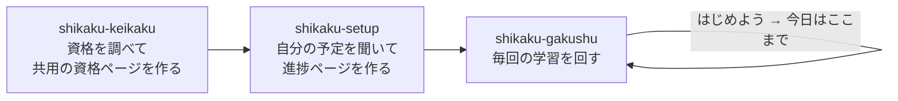
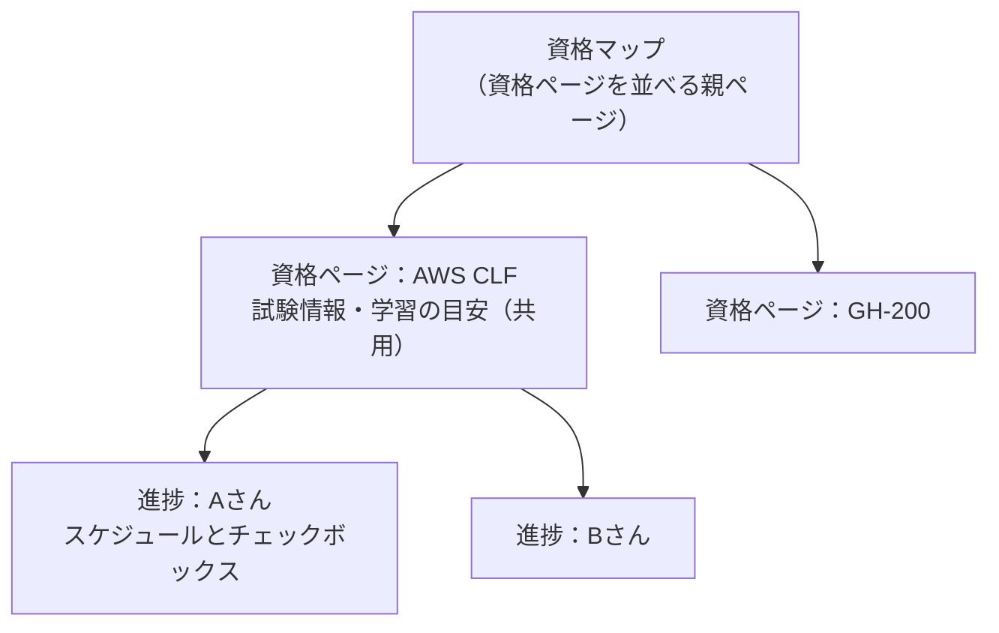

# study-plugins

学びを Claude に伴走してもらうためのプラグイン集です。

| プラグイン | 内容 |
|---|---|
| [shikaku](plugins/shikaku) | 資格勉強の伴走。試験を調べて計画し、自分用のスケジュールを引き、毎回の学習を同じ形で回す |

## shikaku：資格勉強の伴走

「はじめよう」と言うと今日のテーマが出てきて、解説・ハンズオン・問題を進め、「今日はここまで」と言うと進捗が記録される。資格勉強のこの流れを、3つのスキルで回します。



| スキル | いつ使うか | 頼み方の例 |
|---|---|---|
| shikaku-keikaku | 受けたい資格を調べるとき | 「AWS CLF の資格を調べて計画したい」 |
| shikaku-setup | 自分の勉強を始めるとき | 「AWS CLF の勉強を始めたい」 |
| shikaku-gakushu | 毎回の学習 | 「はじめよう」「今日はここまで」 |

### 考え方

- **共用の資格ページと、個人の進捗ページを分ける。** 試験情報や学習時間の目安は誰にでも当てはまるので1枚にまとめ、日程とチェックボックスは受ける人ごとの進捗ページに置きます。1人でも使えますし、家族やチームで同じ資格を受けても互いの進捗がぶつかりません。
- **進捗は進捗ページのチェックボックスだけで数える。** 数える場所が1か所なので、進捗率がぶれません。
- **計画・セットアップ・毎回の学習を分ける。** 資格を調べる作業は1回、スケジュールを引く作業は受ける人ごとに1回、学習は毎日。頻度の違う作業を別のスキルにしています。



### できること

- **計画から遅れたら組み直す。** 「はじめよう」のたびに、日付から見た計画上の位置と実際の進みを比べます。遅れが1週分を超えたら、ならし直す・受験をずらす・範囲を絞る・時間を増やす、の選択肢を数字つきで出します。変更は進捗ページの「計画の変更履歴」に残ります

- **間違えたところを覚えていて、日をあけてもう一度出す。** 間違えたトピックを進捗ページの「弱点メモ」に残し、2日後、1週間後、2週間後と間隔を広げながら、別の角度の問題で復習します。3回続けて正解したら克服です

### 必要なもの

- Claude（claude.ai または Claude Code）
- Notion コネクタ（おすすめ）：資格ページと進捗ページの置き場所。なくても使えます
- Slack コネクタ（任意）：学習の報告を投稿したいとき
- 練習環境（任意）：ハンズオンをする資格の場合。個人のアカウントを使います

### Notion がなくても使えます

資格ページと進捗ページの置き場所は、使える道具に合わせて決まります。

| 保存先 | こんなとき | 置き場所 |
|---|---|---|
| Notion | Notion コネクタをつないでいる | 資格マップの下のページ |
| ファイル | Claude Code など、フォルダにファイルを書ける | `shikaku/<資格名>/` の Markdown ファイル |
| チャット | どちらもない | Markdown の文書。自分でプロジェクトのナレッジに保存して、更新のたびに入れ替えます |

複数人で進捗を見せ合うなら Notion、1人で手軽に試すならファイルが向いています。

### 入れ方

Claude Code の場合：

```
/plugin marketplace add mochico50/study-plugins
/plugin install shikaku@study-plugins
```

claude.ai の場合：TODO（手順を確認して追記）

### 使い方

1. 「◯◯の資格を調べて計画したい」と頼む。公式情報をもとに、資格ページができます
2. 「◯◯の勉強を始めたい」と頼む。予定や経験を聞かれたあと、進捗ページと、プロジェクトに貼る指示文が出てきます
3. 資格ごとに Claude のプロジェクトを作り、指示文を貼る
4. プロジェクトのチャットで「はじめよう」と送る。終えるときは「今日はここまで」

### 気をつけていること

- 問題は、公式の出題範囲とサンプル問題の形式をもとに Claude がオリジナルで作ります。実際の試験問題や市販の問題集は再現しません
- パスワードやアクセスキーは Claude に渡しません。練習環境の作成とログインは本人が行います
- ハンズオンでは、後片付けと、課金が続くリソースの注意まで案内します。勤務先の環境は使いません
- 試験情報は資格ページを作った時点のものです。受験前に公式ページを確認してください

## ライセンス

[MIT](LICENSE)
