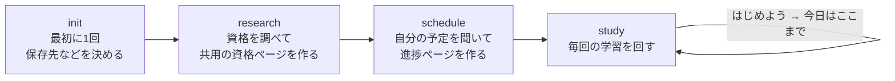
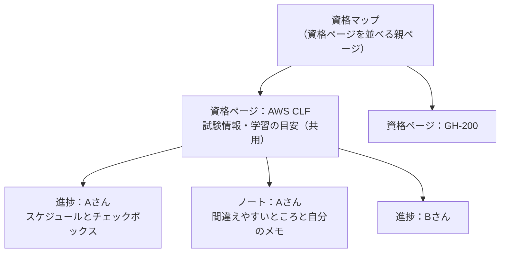

# shikaku：資格勉強の伴走

「はじめよう」と言うと今日のテーマが出てきて、解説・ハンズオン・問題を進め、「今日はここまで」と言うと進捗が記録される。資格勉強のこの流れを、6つのスキルで回します。



| スキル | いつ使うか | 頼み方の例 | コマンド |
|---|---|---|---|
| init | 入れて最初に1回。設定を変えたいとき | 「資格の勉強の準備をしたい」 | `/shikaku:init` |
| research | 受けたい資格を調べるとき | 「AWS CLF の資格を調べたい」 | `/shikaku:research` |
| schedule | 自分の勉強を始めるとき | 「AWS CLF の勉強を始めたい」 | `/shikaku:schedule` |
| study | 毎回の学習、直前、受験後 | 「はじめよう」「今日はここまで」「受けてきた」 | `/shikaku:study` |
| status | いまの進み具合と、次に何をすればよいかを知りたいとき | 「どこまでやったっけ」 | `/shikaku:status` |
| help | 何ができるかを知りたいとき | 「shikaku の使い方を教えて」 | `/shikaku:help` |

ふだんは頼み方の例のように話しかければ、合うスキルが選ばれます。コマンドは、スキルを名指しで呼びたいときに使います。

## 考え方

- **共用の資格ページと、個人の進捗ページを分ける。** 試験情報や学習時間の目安は誰にでも当てはまるので1枚にまとめ、日程とチェックボックスは受ける人ごとの進捗ページに置きます。1人でも使えますし、家族やチームで同じ資格を受けても互いの進捗がぶつかりません。
- **進捗は進捗ページのチェックボックスだけで数える。** 数える場所が1か所なので、進捗率がぶれません。
- **設定・調べる・スケジュール・毎回の学習を分ける。** 設定は最初に1回、資格を調べる作業は資格ごとに1回、スケジュールを引く作業は受ける人ごとに1回、学習は毎日。頻度の違う作業を別のスキルにしています。



## できること

- **計画から遅れたら組み直す。** 「はじめよう」のたびに、日付から見た計画上の位置と実際の進みを比べます。遅れが1週分を超えたら、ならし直す・受験をずらす・範囲を絞る・時間を増やす、の選択肢を数字つきで出します。変更は進捗ページの「計画の変更履歴」に残ります

- **間違えたところを覚えていて、日をあけてもう一度出す。** 間違えたトピックを進捗ページの「弱点メモ」に残し、2日後、1週間後、2週間後と間隔を広げながら、別の角度の問題で復習します。3回続けて正解したら克服です

- **学習ノートが育つ。** 間違えやすかったところの対比や見分け方と、「これをメモして」と頼んだことが、自分用のノートにたまっていきます。ノートは最初に自動で作られます
- **直前は模試と弱点の補強に切り替える。** 受験まで14日を切ると直前モードになり、配点に合わせたミニ模試、分野ごとの正答率、弱い分野の解説し直しを回します
- **受験後の振り返りが、次に受ける人の目安になる。** かかった時間や役に立った教材を進捗ページに残し、本人がよければ共用の資格ページにも足します。受ける人が増えるほど、学習の目安が実態に近づきます

## 必要なもの

- Claude（claude.ai または Claude Code）
- Notion コネクタ（おすすめ）：資格ページと進捗ページの置き場所。なくても使えます
- Slack コネクタ（任意）：学習の報告を投稿したいとき
- 練習環境（任意）：ハンズオンをする資格の場合。個人のアカウントを使います

## Notion がなくても使えます

資格ページと進捗ページの置き場所は、使える道具に合わせて自動で決まります。最初の設定（`/shikaku:init`）で選べて、決めた内容は書き残されるので、以降も同じ場所が使われます。あとから変えたいときも `/shikaku:init` です。

| 保存先 | こんなとき | 置き場所 |
|---|---|---|
| Notion | Notion コネクタをつないでいる | 資格マップの下のページ |
| ファイル | Claude Code など、フォルダにファイルを書ける | `shikaku/<資格名>/` の Markdown ファイル |
| チャット | どちらもない | Markdown の文書。自分でプロジェクトのナレッジに保存して、更新のたびに入れ替えます |

複数人で進捗を見せ合うなら Notion、1人で手軽に試すならファイルが向いています。

ファイルの場合は、こう並びます。

```
shikaku/
├── settings.md              最初の設定
└── aws-clf/
    ├── README.md            資格ページ（共用）
    ├── progress-<名前>.md   進捗ページ（個人）
    └── notes-<名前>.md      学習ノート（個人）
```

このフォルダを Git で管理するかどうかは自由です。履歴を残したい、複数の PC で使いたい、という場合は、自分でリポジトリにしてください。

- コミットと push は自分で行います。shikaku は Git の操作をしません
- 進捗ページは人ごとにファイルが分かれているので、リポジトリを複数人で共有しても、同じファイルを書き換えてぶつかることはほぼありません
- 進捗ページには自分の予定や弱点メモが入ります。公開リポジトリに置くときは、載せてよい内容かを確かめてください

## 入れ方

Claude Code の場合：

```
/plugin marketplace add mochico50/study-plugins
/plugin install shikaku@study-plugins
```

claude.ai での入れ方は、まだ確かめられていません。確認の状況は [docs/compatibility.md](../../docs/compatibility.md) にあります。

## 使い方

1. `/shikaku:init` で最初の設定をする。保存先、名前、報告先の3つを聞かれます。Notion や Slack を使うなら、先に Claude の設定でコネクタをつないでおきます
2. 「◯◯の資格を調べたい」と頼む。公式情報をもとに、資格ページができます
3. 「◯◯の勉強を始めたい」と頼む。予定や経験を聞かれたあと、進捗ページと、プロジェクトに貼る指示文が出てきます
4. 資格ごとに Claude のプロジェクトを作り、指示文を貼る
5. プロジェクトのチャットで「はじめよう」と送る。終えるときは「今日はここまで」
6. 受験したら「受けてきた」と伝える。振り返りを残します

何ができるかを見たいときは `/shikaku:help`、いまの進み具合と次の一歩を知りたいときは `/shikaku:status` を呼んでください。

1 を飛ばして 2 や 3 から始めても大丈夫です。設定がまだなければ、その場で同じ3つを聞かれてから続きます。

## 気をつけていること

- 問題は、公式の出題範囲とサンプル問題の形式をもとに Claude がオリジナルで作ります。実際の試験問題や市販の問題集は再現しません
- パスワードやアクセスキーは Claude に渡しません。練習環境の作成とログインは本人が行います
- ハンズオンでは、後片付けと、課金が続くリソースの注意まで案内します。勤務先の環境は使いません
- 試験情報は資格ページを作った時点のものです。受験前に公式ページを確認してください

## ライセンス

[MIT](LICENSE)
